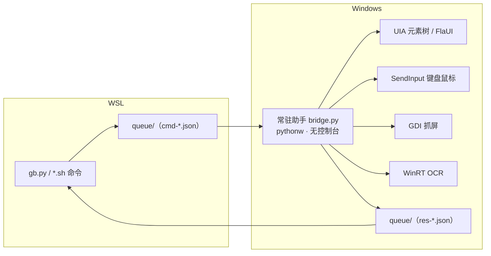

# gui-bridge —— Windows GUI 自动化桥（眼睛 + 手）

在 **WSL 里驱动 Windows 桌面**的轻量桥：抓屏、读取控件树、OCR、模板匹配、点击与键盘输入。用文件队列在 WSL 与 Windows 之间通信，无需开放网络端口、无需安装驱动。

## 架构



设计取舍：
- **常驻助手**：避免每次拉起 PowerShell 造成的高占用与闪窗；常规动作 0.2–0.6s。
- **文件队列通信**：`\\wsl.localhost` 双向可达，免网络配置与防火墙。
- **不依赖 AutoHotkey / WinAppDriver**：直接用原生 UIA 与 SendInput，更稳、零安装。

## 能力

### 眼睛（感知）
| 命令 | 作用 |
|---|---|
| `gb.py shot [--bmp]` | 抓屏（3200×2000 物理像素；`--bmp` 供图像匹配用） |
| `gb.py windows` / `fg` | 顶层窗口清单 / 当前前台窗口 |
| `gb.py elements [深度]` | 前台窗口的 UIA 元素树（结构化视野，最稳） |
| `gb.py ocr [图]` | OCR（Windows 原生，中英文，返回每行/每词坐标） |

### 手（动作）
| 命令 | 作用 |
|---|---|
| `gb.py invoke "按钮名" [--ctype=Button]` | 按控件名点击（UIA，不靠坐标 —— 首选） |
| `gb.py click X Y [--right] [--double]` / `move` | 坐标点击 / 移动 |
| `gb.py drag X1 Y1 X2 Y2` / `scroll N [x y]` | 拖拽 / 滚轮 |
| `gb.py type "文字"` / `key "ctrl+s"` / `keydown|keyup` | 输入 / 组合键 / 按住松开 |
| `gb.py focus "标题片段"` | 把窗口切到前台 |

### 兜底（无控件信息时）
| 命令 | 作用 |
|---|---|
| `gb.py findtext "文字"` / `clicktext "文字"` | OCR 找字 → 坐标 / 直接点击 |
| `gb.py findimg 模板图` / `clickimg 模板图` | 模板匹配（NCC）→ 坐标 / 直接点击 |
| `gb.py crop <图> <出.png> x y w h` | 从截图裁一块作模板 |

## FlaUI 工业级后端

免安装：FlaUI 5.0.0（net48）三个 DLL 放 `flaui/bin/`，用系统自带 PowerShell 5.1 直接加载（首次自动缓存到 `%LOCALAPPDATA%\gui-bridge-flaui\bin`），无需 .NET SDK。

入口三选一：
- 命令行：`./flaui.sh windows` ｜ `./flaui.sh tree -Window '文件资源管理器' -Depth 3` ｜ `./flaui.sh find -Name '查看'` ｜ `./flaui.sh click -Name '最小化'` ｜ `./flaui.sh settext -Name '<框>' -Value 'x'`
- Python：`import flaui` → `flaui.windows()` / `flaui.find("查看", window="…")` / `flaui.click("最小化")`
- 桥内：`gb.py` 发 `{"cmd":"flaui","args":{"sub":"find","name":"查看","window":"…"}}`

子命令：`windows / tree / find / click / settext / text / focus / focuswin`。

相对 `gb.py elements/invoke`（uiautomation 后端）的优势：拿到真 **AutomationId** 与 **Invoke/Value Pattern**（优先 UI 模式点击，失败才回落鼠标），坐标与截图一致（per-monitor v2 物理像素），跨进程更稳。

## 安全设计

1. **显式开关**：没有 `on.sh`，一切动作被拒（`off.sh` 立即收回）。
2. **分级**：`eyes`（看）与 `hands`（点/输入）分离；`--eyes-only` 退化为只读。
3. **全程留痕**：每个动作进 `audit.log`；`--timed` 可选限时。

## 视觉解析实验（OmniParser 路线）

链路：YOLO（icon_detect）找图标 → Florence-2（icon_caption）给图标语义 → Windows OCR 找文字 → 合成 `out/omniparser_result.json` + overlay 图。脚本 `lib/omni_test.py`。

上层（`lib/omni_cloud.py`，走云 VLM 兜底，只处理需要补描述的目标）：
- 支持 `--ground`（整屏 grounding：输出「功能|x|y」元素表）、`--scene`（一句话场景）、`--crop <png>`（单张试）。
- 云 VLM 给**短中文功能名**，可用度明显高于本地泛描述。

## 踩过的坑（都写进代码了）

1. WSL→Windows **不传自定义环境变量** → 必须用 `WSLENV=VAR`。
2. GDI+ **不能直接存 `\\wsl.localhost`** → 走 MemoryStream + `File.WriteAllBytes`。
3. 不启 DPI 感知只有逻辑分辨率 → 助手启动即 **per-monitor v2**，全程物理像素；截图 / 窗口 rect / 点击 三者坐标空间必须一致。
4. 心跳会"假活" → 改用 **ping 握手**，假活则强杀重启；`img.py` 需 reload。
5. 文件队列偶发可见性延迟 → 超时**不自动重试**（防点击/输入重复执行）。
6. **相对路径会拼出畸形 UNC** → 一律 `abspath`，助手侧校验 `unc_path()`。
7. **PS 5.1 读无 BOM 的 UTF-8 脚本按 ANSI 解码**，中文会坏脚本 → 脚本存为 UTF-8 with BOM。
8. **WinRT OCR 不要传显式像素格式重载**（会崩），默认即 Bgra8。
9. PS 重定向下**中文输出是 GBK** → 先设 `[Console]::OutputEncoding = UTF8`。
10. OCR 对 **CJK 会插空格**（"微 信"）→ 匹配前先去空格。
11. **GDI 句柄必须声明 argtypes**：漏声明会让 64 位句柄被按 `c_int` 转换，句柄 ≥ 2^31 时报 `OverflowError`，表现为抓屏时灵时不灵。
12. WinRT OCR 对**小字号/低对比**不可靠 → 小目标优先走 UIA 元素树（`invoke`）。

## 运行

```bash
./on.sh                 # 开启（眼睛 + 手）
./on.sh --eyes-only     # 只给眼睛（只看不动）
./on.sh --timed 30      # 可选限时
./off.sh                # 关闭     ./status.sh   # 状态 + 审计
```
